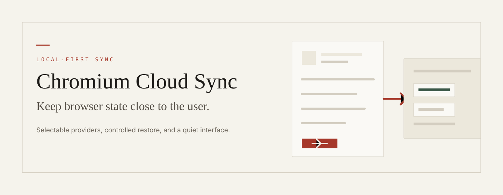
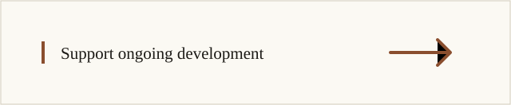

<div align="center">

<picture>
  <source media="(prefers-color-scheme: dark)" srcset="assets/readme/hero-wabi-dark.svg">
  
</picture>

<p>
  
  
  
  
</p>

<p><strong>Sync the browser state that Chromium browsers leave disconnected.</strong></p>

<p>
  <a href="#readme-overview">Overview</a> ·
  <a href="#readme-features">Features</a> ·
  <a href="#readme-providers">Cloud providers</a> ·
  <a href="#readme-storage-layout">Storage layout</a> ·
  <a href="#readme-gdrive-auth">Google Drive auth</a> ·
  <a href="#readme-sync-model">Sync model</a> ·
  <a href="#readme-data-scope">Data scope</a> ·
  <a href="#readme-extension-recovery">Extension recovery</a> ·
  <a href="#readme-security">Security</a> ·
  <a href="#readme-installation">Installation</a> ·
  <a href="#readme-usage">Usage</a> ·
  <a href="#readme-history">History</a> ·
  <a href="#readme-architecture">Architecture</a> ·
  <a href="#readme-development">Development</a> ·
  <a href="#readme-status">Status</a> ·
  <a href="#readme-support">Support</a> ·
  <a href="#readme-license">License</a>
</p>

</div>

---

<a name="readme-overview"></a>

##  Overview

**Chromium Cloud Sync** is a Manifest V3 browser extension for synchronizing Chromium browser state across devices through a selectable cloud provider, without depending on a browser vendor's built-in sync service.

The current implementation synchronizes tab groups and their HTTP(S) member tabs, bookmarks, and installed third-party extension metadata. Standalone tabs and whole-window layouts are not uploaded. It also provides extension recovery with optional user-supplied GitHub links for missing extensions.

<a name="readme-features"></a>

##  Features

| Capability                    | Description                                                                                                           |
| :---------------------------- | :-------------------------------------------------------------------------------------------------------------------- |
| **Tab groups**                | Synchronize group identity, title, color, collapsed state, and member tabs needed to restore each group; standalone tabs and whole-window layouts are excluded. |
| **Bookmarks**                 | Sync bookmark titles, URLs, parent relationships, order, and stable IDs.                                              |
| **Extension inventory**       | Track third-party extension ID, name, version, enabled state, installation type, update information, and store links. |
| **Extension Recovery Center** | Detect missing extensions and surface available Chrome Web Store, Edge Add-ons, or compatible recovery links.         |
| **Three-way merge**           | Merge base, local, and remote snapshots instead of blindly replacing one side.                                        |
| **Deletion tombstones**       | Preserve deletions so stale devices do not silently recreate removed items.                                           |
| **Conflict visibility**       | Keep unresolved field conflicts explicit for review.                                                                  |
| **Provider-independent sync** | Run manual and automatic synchronization through the selected cloud provider.                                         |
| **Automatic sync**            | Optional background synchronization with configurable intervals; disabled by default.                                 |
| **History & rollback**        | Use provider-native history where supported; normal sync does not create a separate application history archive.     |
| **Extension recovery**         | Restore missing extensions using store links or a GitHub download URL entered and remembered locally by extension ID. |
| **Bilingual UI**              | English and Simplified Chinese interfaces.                                                                            |
| **Theme controls**            | Explicit theme controls for settings and auxiliary pages.                                                             |

<a name="readme-providers"></a>

##  Cloud providers

The synchronization engine is separated from the storage backend. Choose the provider that fits the environment:

| Provider         | What it stores                                   | Authentication / access                                     | History source                         |
| :--------------- | :----------------------------------------------- | :---------------------------------------------------------- | :------------------------------------- |
| **GitHub Gist**  | Modular sync files (see below) inside one Gist   | GitHub Token + private Gist                                 | Gist revision / commit history         |
| **Google Drive** | Modular sync files inside an application folder  | Packaged Google account authorization; optional own Web application client as an Advanced fallback | No app-managed history archives |
| **WebDAV**       | Modular sync files only                          | WebDAV URL, optional folder, username and password/app auth | No app-managed history archives |

For GitHub Gist, the extension creates or binds a private Gist. Google Drive uses the `drive.file` scope and keeps its authorization state in the local browser profile. WebDAV requests require the user to grant access to the configured server origin.

<a name="readme-gdrive-auth"></a>

### Connecting Google Drive

Google Drive normally connects through the browser's Google account chooser; the extension uses its packaged public OAuth client and requests the `drive.file` scope. Users do not need to create their own OAuth client when the installed build has a client configured. If the account chooser is unavailable, expand **Advanced: use your own OAuth client** in Settings and follow the on-screen redirect URI instructions. This fallback requires a Google OAuth **Web application** client; a **Chrome Extension** client registered only with an Item ID is not compatible with this redirect-based flow.

1. For a build without a packaged client, in Google Cloud Console open **APIs & Services → Credentials** and create an OAuth client ID of type **Web application**. Skip these setup steps when using a build with a configured packaged client.
2. In that client's **Authorized redirect URIs**, add the exact URI shown in ChromiumCloudSync's expanded Google Drive OAuth settings. It must match `chrome.identity.getRedirectURL()` exactly; the usual form is `https://<extension-id>.chromiumapp.org/`, including the trailing slash.
3. Copy the extension ID from the actual installed build in `chrome://extensions`. Do not assume an unpacked/development build has the same ID as the Chrome Web Store listing or release CRX. Each distinct extension ID needs its own authorized redirect URI.
4. If Google's OAuth consent screen is in **Testing** mode, add the Google account you are signing in with to its **Test users** list. Ensure the Google Drive API is enabled in the same Google Cloud project.
5. For maintainers building a release, set `GDRIVE_OAUTH_CLIENT_ID` under **Settings → Secrets and variables → Actions → Variables** to the Web application client's public Client ID. The client ID is injected into the build; no Client Secret is bundled.
6. The release build injects the public Client ID into the generated `options.js` runtime configuration, **not** `manifest.oauth2`. That manifest field is for Chrome Extension clients consumed by `getAuthToken`, whereas this flow uses a Web application client with `launchWebAuthFlow`. The options page sends a PKCE authorization-code request with `response_type=code`, the `drive.file` scope, and the exact redirect URI. The extension exchanges the code with the verifier and keeps the resulting refresh token in local extension storage only; no Client Secret is bundled.
7. For another Chromium installation or an unpacked build with a different ID, add that build's exact redirect URI as an additional **Authorized redirect URI** to the same Web application client, or configure a separate Web application client ID. The Advanced/manual OAuth path also uses Web application credentials with PKCE.

The extension-specific redirect approach follows the pattern used by the [Read Frog Google Drive sync implementation](https://github.com/mengxi-ream/read-frog/pull/726), while retaining ChromiumCloudSync's existing file layout and least-privilege `drive.file` scope.

All three providers store the same set of independent module files — the provider only decides where those files live and how it versions them.

<a name="readme-storage-layout"></a>

### Cloud storage layout

Synchronized data is **not** one monolithic file. Each synchronized resource is stored independently so it can be uploaded, downloaded, and versioned on its own:

| File                 | Contents                                                                  |
| :------------------- | :------------------------------------------------------------------------ |
| `manifest.json`      | Storage layout, schema version, module index, legacy archive pointer       |
| `meta.json`          | Revisions, tombstone counts, migration record, orphan tombstones           |
| `extensions.json`    | Extension inventory module                                                 |
| `bookmarks.json`     | Bookmark collection module                                                 |
| `tabs.json`          | Tab-group metadata and member tabs needed to restore each group; no standalone tabs or window snapshots |

Metadata and schema information stay in separate files rather than being mixed into synchronized data. New syncs do not create application-managed history indexes or copy previous module files into cloud archives. Recognized app-managed history indexes and their indexed archives—including legacy single-file WebDAV entries—are removed on the next successful sync; provider-native revision mechanisms are left untouched.

Because only the modules whose data actually changed are uploaded, a bookmark edit re-writes `bookmarks.json` and the two control files while `extensions.json` and `tabs.json` stay byte-identical and keep their own module revision. Merging and conflict detection are module-scoped as well: a conflict is attributed to the module that owns it.

Settings → **Local** shows this layout live: the active layout, schema and storage-format versions, and every module file with its revision, deletion count, and checksum.

#### Upgrading from `current.json`

Existing cloud data is migrated automatically and non-destructively:

1. A remote that still holds `current.json` (or the older `chromium-cloud-sync.json`) is detected on the next read.
2. The legacy payload is validated, then split into the module files above, carrying its revision forward so module revisions stay continuous.
3. The migration is recorded in `meta.json` and `manifest.json` with the new storage layout and format version.
4. The legacy `current.json` is **kept** as a read-only archive — it is never deleted or reset by the migration, so the previous data remains recoverable.
5. If a device that has not upgraded yet writes a newer `current.json` afterwards, that newer payload wins and the migration record is re-created against it.
6. An incomplete module set is reported as an explicit error instead of being presented as a valid partial state.

Popup restore, cloud tab management, and history keep reading one coherent overall synchronization state — the split is a storage detail, not a user-facing concept.

<a name="readme-sync-model"></a>

##  Sync model

Chromium Cloud Sync uses a **local-first three-way merge** rather than a simple latest-device-wins strategy.

```text
              Local base snapshot
                       │
             ┌─────────┴─────────┐
             ▼                   ▼
       Current local        Current remote
             │                   │
             └─────────┬─────────┘
                       ▼
                Three-way merge
                 ┌─────┴─────┐
                 ▼           ▼
          auto-resolve    conflict
                 │           │
                 └─────┬─────┘
                       ▼
                New revision
```

The merge engine uses field-specific policies, including latest-value resolution for ordinary metadata, version comparison for extension versions, and manual conflicts when fields such as URLs are independently changed. Deletions are represented by tombstones.

The current cloud schema is **v11**, with migration support for schemas **7, 8, 9, 10 and 11**.

<a name="readme-data-scope"></a>

##  Data scope

### Synchronized

```text
Tab groups and their HTTP(S) member tabs
Bookmarks
Third-party extension metadata
```

### Explicitly outside the sync snapshot

```text
Third-party extension private storage / settings
Browser passwords
Authentication credentials
Unrelated extension-private data
Browser-level settings
```

Third-party extension settings are intentionally excluded because a generic Chromium extension cannot safely read or write another extension's private storage.

<a name="readme-extension-recovery"></a>

##  Extension recovery

The extension inventory stores enough metadata to identify missing third-party extensions. The **Extension Recovery Center** can show extensions present in the cloud inventory but absent locally and provide direct store links when available.

When an official store link is unavailable or unsuitable for the current browser, the recovery flow can expose a third-party download/search path with an explicit warning. Installation remains an explicit browser action.

<a name="readme-security"></a>

##  Privacy & security

New GitHub synchronization Gists are created as **private Gists**. The current synchronization payload is stored as normal JSON and is **not end-to-end encrypted**. Access to a configured sync backend can therefore expose the synchronized browser state.

For Google Drive, OAuth credentials are stored in `chrome.storage.local` and the implementation requests the `drive.file` scope. For WebDAV, the configured credentials are stored locally and requests use HTTP Basic Authentication.

The repository still contains compatibility handling for older encrypted synchronization data, but that is a migration path rather than the format used for new synchronization state.

GitHub download links entered for missing extensions are stored locally by extension ID and are not uploaded.

<a name="readme-installation"></a>

##  Installation

Open [Releases](https://github.com/CYoJkoY/ChromiumCloudSync/releases) and download the latest ZIP or CRX.

For the ZIP:

1. Extract the archive.
2. Open `chrome://extensions` or your browser's equivalent extension page.
3. Enable **Developer mode**.
4. Select **Load unpacked**.
5. Choose the extracted directory.

The release workflow validates the version, runs tests and a Chromium smoke test, builds the ZIP, verifies its contents, creates a signed CRX3, generates SHA-256 checksums, and publishes all release artifacts.

### Initial configuration

Open **Settings** and configure the provider you want to use:

1. **GitHub Gist** — enter and validate a GitHub Token, then create or bind a private sync Gist.
2. **Google Drive** — select **Google Drive** and choose **Connect with Google account**. If the browser-managed account chooser is unavailable, expand **Advanced: use your own OAuth client** and follow the on-screen setup instructions. Release maintainers can optionally package a client ID into their build.
3. **WebDAV** — enter the server URL and optional remote folder, credentials, then test the connection.
4. Run **Sync now** once.
5. Enable automatic synchronization when required.

<a name="readme-usage"></a>

##  Usage

The popup provides the operational status of the connection and synchronization state, including provider binding, last sync time, revision, conflict count, and automatic-sync state.

Automatic synchronization is **off by default** and uses **5 minutes** as its default interval. Available intervals are 5, 10, 15, 30, and 60 minutes.

<a name="readme-history"></a>

##  History & rollback

- GitHub Gist retains its provider-native revision/commit history.
- Google Drive and WebDAV no longer create application-managed cloud snapshots or a `history/index.json` archive during normal sync.
- Google Drive may retain revisions according to Google's own Drive revision policy; the extension does not create extra history copies.

The extension no longer provides app-managed rollback snapshots for Drive/WebDAV. Recognized legacy app-managed archives are cleaned up after the next successful sync; Gist's provider-native history is unaffected.

<a name="readme-architecture"></a>

##  Architecture

```text
Chromium Cloud Sync
├── runtime/
│   ├── background.ts            orchestration + provider dispatch
│   ├── browser-capabilities.ts
│   ├── cloud-tab-state.ts       canonical cloud-tab projection
│   ├── diagnostics.ts
│   ├── legacy-crypto.ts
│   ├── schema.ts                validation + version migration
│   ├── storage.ts               serialized local mutations
│   ├── sync-core.ts             per-module merge, tombstones, checksums
│   ├── sync-modules.ts          modular storage domain (split/combine/migrate)
│   └── types.ts
├── cloud providers/
│   ├── cloud-files.ts           provider-agnostic FileStore protocol
│   ├── cloud-gist.ts            GitHub Gist transport
│   ├── cloud-gdrive.ts          Google Drive transport
│   └── cloud-webdav.ts          WebDAV transport
├── features/
 │   └── update.ts
└── ui/
    ├── popup / options / guide / history / extensions
    ├── i18n.ts
    ├── theme.ts
    └── styles/
```

The runtime layer coordinates browser APIs, local storage, provider dispatch, diagnostics, schema migration, and synchronization. `sync-core.ts` contains per-module merge and tombstone logic; `sync-modules.ts` owns the modular storage layout (module split/combine, per-module revisions and change detection, legacy migration); `schema.ts` validates and migrates cloud state.

`cloud-files.ts` defines one provider-agnostic file protocol — read, write, remove, list, and history — and each provider module implements only file placement, transport, and its native history model. Adding a provider therefore does not require touching merge, migration, or history semantics, and no provider needs to know how another one stores files. The UI layer provides the operational surfaces.

For module ownership, synchronization flow, change recipes, and contributor setup, see the [Contributor Guide](docs/ARCHITECTURE.md).

<a name="readme-development"></a>

##  Development

### Requirements

- Node.js 24
- npm
- TypeScript
- Playwright with Chromium

Runtime source is maintained in TypeScript. The release workflow rejects tracked `.js` source files and generates JavaScript during the build.

### Common commands

```bash
npm install
npm run typecheck
npm test
npm run validate
npm run build:zip
npm run smoke
```

### Release workflow

```text
Git tag
   │
   ├─ version validation
   ├─ TypeScript validation
   ├─ unit / invariant / schema / storage tests
   ├─ Playwright browser smoke test
   ├─ ZIP build
   ├─ ZIP contents verification
   ├─ signed CRX3 build
   ├─ SHA-256 checksums
   └─ GitHub Release
```

Stable tags use `vX.Y.Z` and are published as normal GitHub Releases. ChromiumCloudSync uses a single stable release channel; `version_name`, `.devN` tags, and pre-releases are not used.

#### Configuring the CRX signing key

The Release workflow expects a repository secret named `CRX_PRIVATE_KEY_B64`. It now accepts either a raw PEM private key or a Base64-encoded PEM. A key generated with `openssl genpkey` (PKCS#8, `BEGIN PRIVATE KEY`) is supported; the workflow validates the RSA key and normalizes it before signing. Keep using the **same private key for every release** because replacing it changes the CRX's signing identity.

Recommended Base64 setup on Windows PowerShell:

```powershell
# Encode the complete PEM file as one Base64 line and copy it to the clipboard.
$privateKeyPath = (Resolve-Path .\private.pem).Path
[Convert]::ToBase64String([IO.File]::ReadAllBytes($privateKeyPath)) | Set-Clipboard
```

On Linux, macOS, or Git Bash, print a single-line Base64 value with:

```bash
base64 < private.pem | tr -d '\n'
```

Then open **Settings → Secrets and variables → Actions → Repository secrets → New repository secret**, name it `CRX_PRIVATE_KEY_B64`, and paste the copied one-line value. Do not include surrounding quotes, command output labels, or the PEM header/footer in addition to the Base64 value. Alternatively, paste the complete multi-line PEM content directly as the secret value; the updated workflow detects that form automatically.

The release workflow reports a specific decoding or key-validation error if the secret is malformed; it never prints the private key to the job log. Never commit `private.pem` to the repository or send it in an issue.

<a name="readme-status"></a>

##  Project status & roadmap

The current core is browser-state synchronization and extension inventory/recovery.

Current providers are GitHub Gist, Google Drive, and WebDAV.

Future work is expected to expand browser-state coverage carefully. **Extension settings** and **browser settings** are roadmap items, not synchronized data in the current release.

<a name="readme-support"></a>

##  Support

Support helps fund compatibility testing, synchronization reliability work, documentation, and continued maintenance.

[Open the Chromium Cloud Sync support page](https://cyojkoy.github.io/Payment/)

<a href="https://cyojkoy.github.io/Payment/">
  <picture>
    <source media="(prefers-color-scheme: dark)" srcset="assets/readme/support-cta-dark.svg">
    
  </picture>
</a>

Use [GitHub Issues](https://github.com/CYoJkoY/ChromiumCloudSync/issues) for bugs, compatibility problems, synchronization conflicts, schema issues, and feature requests.

Never include GitHub Tokens, private credentials, or sensitive Gist contents in an issue.

<a name="readme-license"></a>

##  License

Chromium Cloud Sync is released under the **MIT License**. See [`LICENSE`](LICENSE) for the full license text.

<div align="center">

[](https://github.com/CYoJkoY/ChromiumCloudSync)

</div>
